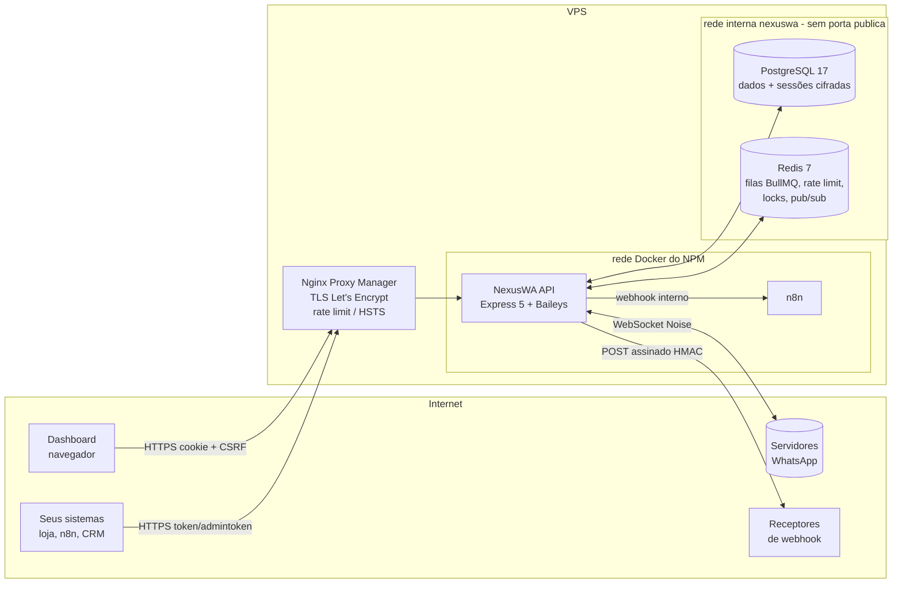

# Arquitetura do NexusWA

## Mapa

## Camadas (dentro da API)

| Camada | Pasta | Responsabilidade |
|---|---|---|
| Borda HTTP | `app.ts`, `middlewares/` | Helmet, CORS, limite de corpo, rate limit, autenticação, CSRF, request-id, log |
| Rotas | `routes/` | Validação Zod de entrada, autorização da rota, formato de resposta uazapi |
| Serviços | `services/` | Regras de negócio: envio, fila, campanhas, webhooks, mídia, SSE |
| Domínio WhatsApp | `whatsapp/` | Sessão Baileys, persistência de eventos, normalização |
| Infra | `lib/` | Prisma, Redis, criptografia, SSRF, locks, circuit breaker, métricas |

## Fluxos principais

**Envio síncrono** (`POST /send/*`): valida (Zod) → resolve a instância (token ou dono) → rate limit por instância → idempotência → `executeSend` → Baileys → grava a mensagem → resposta.

**Envio assíncrono** (`async: true`): a mensagem é gravada como `Queued` e vai para a fila BullMQ da instância (concorrência 1 e intervalo aleatório). O worker envia quando a sessão está pronta; sem sessão, adia sem gastar tentativa.

**Campanhas** (`/sender/*`): as mensagens são validadas e gravadas em lote. O worker faz polling a cada 2s, reivindica a próxima mensagem com `UPDATE ... FOR UPDATE SKIP LOCKED` (nunca envia em duplicidade, mesmo com várias réplicas) e grava `nextSendAt` antes de enviar.

**Eventos**: o Baileys emite eventos, que são persistidos e publicados no `eventBus` (padrão Observer). Dali seguem para dois caminhos:
- Webhooks: fila BullMQ, 6 tentativas com backoff exponencial, circuit breaker por destino, verificação SSRF e assinatura HMAC.
- SSE: Redis pub/sub, o que funciona em qualquer réplica.

## Escala e resiliência

| Tema | Solução |
|---|---|
| Cache | Redis: rate limit, idempotência, cache de config de webhook (30s), cache de metadados de grupo |
| Mensageria | BullMQ (Redis) para envio async e entrega de webhooks. Jobs sobrevivem a restart. |
| Escala horizontal | HTTP é stateless (JWT e tokens no banco), então dá para balancear réplicas. Cada **sessão WhatsApp** fica presa a um nó por lock distribuído no Redis (TTL de 30s, renovado a cada 10s). Uma rota para uma sessão de outro nó responde 409. |
| Idempotência | `Idempotency-Key`; `jobId = messageId` no BullMQ; upsert por ID de mensagem; status monotônico (nunca regride) |
| Circuit breaker | Por origem de webhook: 5 falhas → 60s aberto → half-open |
| Observabilidade | Logs JSON (pino) com `requestId` e redação de segredos; métricas Prometheus em `/metrics` (token); `/health` e `/ready` |
| Shutdown gracioso | SIGTERM → fecha HTTP → solta locks → fecha sockets **sem logout** (sessões voltam no boot) |
| Reconexão | Backoff exponencial com jitter (1s a 60s, 12 tentativas); `loggedOut` limpa credenciais; `connectionReplaced` não reconecta |

## Dados

- **Isolamento multi-tenant**: `Instance.ownerId → User`. Toda tabela de domínio carrega `instanceId`, e toda query filtra pelo `instanceId` da credencial validada, nunca por um ID vindo do corpo da requisição.
- **Cifrado em repouso (AES-256-GCM + AAD)**: credenciais Baileys, segredos de webhook, chave OpenAI, URL de proxy e segredo TOTP.
- **Hash**: senhas (Argon2id), tokens de instância e refresh tokens (SHA-256).
- **Retenção**: mensagens por 7 dias (configurável), arquivos por 48h, auditoria por 1 ano.
- **Travas de concorrência**: `SKIP LOCKED` (campanhas), transação `Serializable` (cota de instâncias), `updateMany` condicional (rotação de refresh token), lock Redis (sessão e manutenção).
